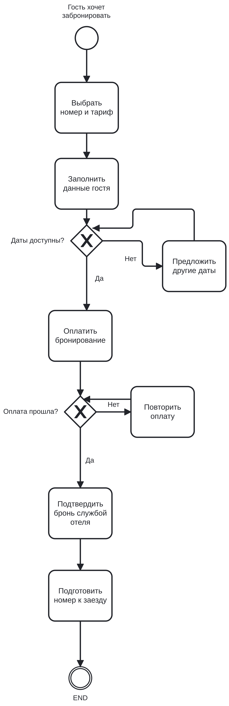
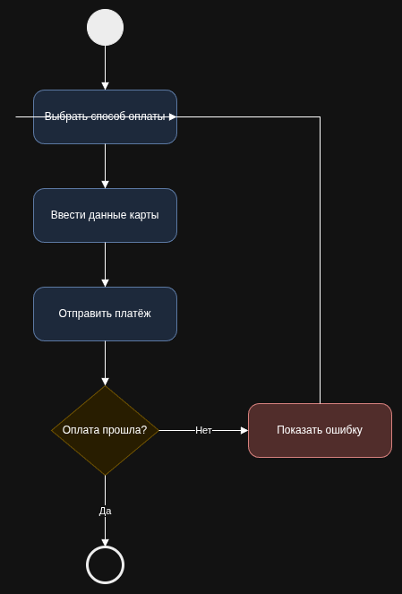

# Отчет по лабораторной работе №1
**Тема:** Моделирование процессов с использованием Git и визуальных нотаций  
**Выполнил студент:** Гавриловец Илья  

---

## 1. Описание процесса
В рамках лабораторной работы был описан и смоделирован бизнес-процесс.  
Подробное пошаговое описание шагов, ролей и логики ветвлений содержится в файле:  
[docs/process_description.md](docs/process_description.md)

---

## 2. Диаграммы

### 2.1. BPMN Диаграмма
* **Исходный файл:** `diagrams/process.bpmn`  
* **Изображение процесса:**  

---

### 2.2. UML Activity Диаграмма
* **Исходный файл:** `diagrams/activity.drawio`  
* **Изображение процесса:**  

---

### 2.3. Sequence Диаграмма
Диаграмма последовательности сообщений выполнена в синтаксисе Mermaid.  
Код и визуализация доступны в файле:  
[docs/sequence.md](docs/sequence.md)

---

### 2.4. Flowchart (Блок-схема)
Блок-схема алгоритма выполнена в синтаксисе Mermaid.  
Код и визуализация доступны в файле:  
[docs/flowchart.md](docs/flowchart.md)

---

## 3. Исследование версионирования (Git Diff)

В ходе работы были внесены минорные изменения в диаграммы для проверки работы системы контроля версий Git с различными типами файлов:
1. **Текстовые форматы (`.bpmn`, `.drawio`, `.md`):**  
   Git отслеживает изменения построчно. Команда `git diff` позволяет увидеть каждую добавленную, измененную или удаленную строчку XML-кода диаграммы.
2. **Бинарные форматы (`.png`):**  
   Для растровых изображений Git не может показать дифференциацию пикселей и выводит сообщение `Binary files differ`. Хранить исходные схемы в репозитории предпочтительно в текстовом виде.

---

## 4. Выводы
В процессе выполнения лабораторной работы были закреплены навыки работы с распределенной системой контроля версий Git (коммиты, ветвление, фиксация изменений). Освоены графические нотации BPMN и UML Activity, а также описание схем через код Mermaid. На практике изучено поведение Git при сравнении текстовых и бинарных данных.
