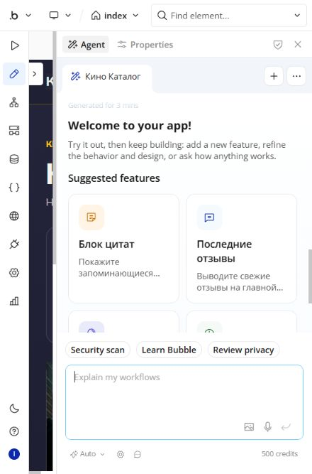

# Лабораторная работа №3. Bubble

**Студент** Илья Гавриловец

**Группа** СДП-ИИ-241

## Приложение и генерация

«Кино Каталог» — публичный учебный каталог фильмов и отзывов. Главная страница состоит из шапки с навигацией и поиском, основного блока с фильтрами и карточками и подвала с подписью автора. Bubble AI создал каркас, включая страницы каталога, добавления и деталей фильма, типы «Фильм» и «Отзыв» и базовые workflows.

### Исходный промпт из истории Bubble AI

```text
Создай приложение на тему «Каталог фильмов»
Пусть этот сайт будет публичный
Страницу обязательно создай по структуре header + body + footer
Обязательно укажи в заготовке следующую строку: «ТВП: Гавриловец»
Добавь несколько интерактивных элементов (реализующих CRUD)
```



## Dev-версия

[Кино Каталог](https://my-app-261029-47963.bubbleapps.io/version-test/) · [Журнал просмотров](https://my-app-261029-47963.bubbleapps.io/version-test/watch_log)

## Build Guides

- **Movie database** объясняет, как показать записи из базы через repeating group. Этот подход применён в журнале просмотров. Для каталога также добавлена статистика, которая считает фильмы по жанрам. [Руководство](../screenshots/02-buildguide-movie-database.png)
- **Search functionality** показывает, как передать поисковый текст в запрос и обработать пустой результат. В каталоге есть поиск по названию, в журнале предусмотрен пустой список. [Руководство](../screenshots/02-buildguide-search.png)

Под фильтрами добавлен блок статистики по жанрам. [До](../screenshots/02-before-heading.png) · [После](../screenshots/02-after-genre-statistics.png)

## Ручные изменения

- Заголовок «Каталог фильмов — Илья Гавриловец». [Снимок](../screenshots/02-after-heading.png)
- В Global → Variables создан Cinema Accent (`#FFD56B`). Стиль Watch Log Accent использует его для фона кнопки «Добавить». [Цвет](../screenshots/03-global-variable.png) · [Стиль](../screenshots/04-style.png)
- Из библиотеки Components перетащён готовый блок Marketing. После адаптации он показывает подсказку «Заметки после просмотра». [Компонент](../screenshots/05-component.png)

## Data и Workflows

Тип **WatchEntry** создан вручную. Поля `movie_title` и `notes` имеют тип text, `watched_on` — date, `would_recommend` — yes/no. В App Data вручную добавлены «Солярис» и «Человек с киноаппаратом». [Тип данных](../screenshots/06-data-type.png) · [Две записи](../screenshots/07-data-records.png)

| Операция | Проверка в Preview | Снимок |
| --- | --- | --- |
| Create | Кнопка «Добавить» создала запись «Тест CRUD — 22.11». | [Preview после сохранения и правки](../screenshots/08-workflow-create.png) · [Workflow](../screenshots/09-workflow-create.png) |
| Read | Кнопка «Обновить список» перечитала записи и показала «Список обновлён». | [Workflow](../screenshots/12-workflow-read.png) |
| Update | Изменена заметка тестовой записи. Изменение осталось после перезагрузки. | [Workflow](../screenshots/13-workflow-update.png) |
| Delete | В подтверждении указано имя тестовой записи. После подтверждения она исчезла, две демонстрационные записи остались. | [Workflow](../screenshots/10-workflow-delete.png) · [Подтверждение](../screenshots/14-preview-delete-confirm.png) · [Результат](../screenshots/15-preview-delete-result.png) |

## Дополнительные промпты

**Подбор полей**

> Предложи новый тип данных Bubble для журнала просмотров в приложении «Кино Каталог». Нужны название фильма, дата просмотра, рекомендация и заметка. Дай английские имена для типа и полей и укажи типы Bubble.

**Статистика**

> Добавь на Главную страницу небольшой блок статистики, который показывает, сколько фильмов в каталоге по каждому жанру в виде простого списка или диаграммы.

**Страница журнала**

> В этом приложении создай новую страницу watch_log под названием «Журнал просмотров». Используй существующий тип WatchEntry с полями movie_title (text), watched_on (date), would_recommend (yes/no), notes (text). Создай форму добавления (название обязательно, дата обязательна, чекбокс и заметка), repeating group с записями по убыванию даты, кнопку «Обновить список», кнопки редактирования и удаления для каждой записи, всплывающую форму редактирования с текущими значениями и подтверждение удаления. Настрой четыре отдельных frontend workflow: добавление WatchEntry из формы, чтение по кнопке «Обновить список», изменение выбранного WatchEntry и удаление выбранного WatchEntry после подтверждения. Отображай пустое состояние, если записей нет. Все видимые надписи должны быть на русском. Добавь ссылку «Журнал просмотров» в навигацию главной страницы и ссылку обратно в каталог на новой странице. Сохрани текущую тёмную тему каталога.

**Уточнение**

> Примени план с двумя изменениями: не создавай тестовые записи, я добавлю их вручную в App Data. Не меняй privacy rules уже существующего публичного WatchEntry. Остальные шаги создания страницы и CRUD сохрани.

## Вывод

Repeating group выводит записи поиска без ручного заполнения каждой карточки. В операциях редактирования и удаления надо передавать текущий объект из выбранной карточки. Глобальная переменная и стиль задают оформление кнопки из одного места. Проверка в Preview показала, что изменения сохраняются в dev-базе.
