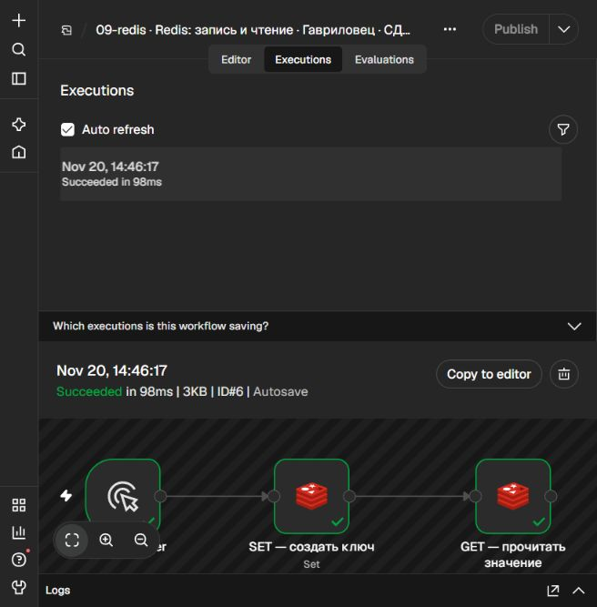
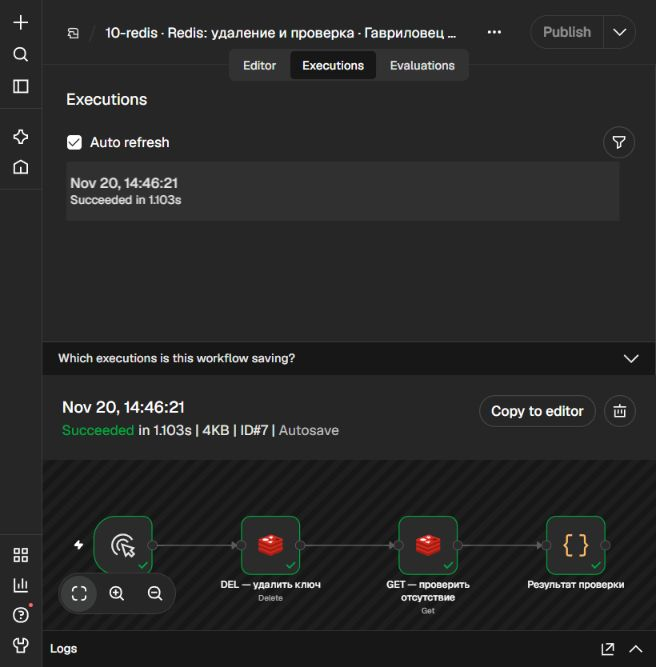

# Redis в n8n

Redis 7 запускается в том же Docker Compose проекте, что и n8n. У порта Redis локальная привязка к `127.0.0.1:6379`. На Docker Desktop n8n обращается к нему через хостовый адрес `host.docker.internal`.

1. Запустить `docker compose up -d` из папки `lab4`.
2. Проверить Redis командой `docker compose exec redis redis-cli PING`. Ответ — `PONG`.
3. В n8n создать credentials типа Redis. Host — `host.docker.internal`, Port — `6379`, Database — `0`, SSL выключен. Для локального контейнера пароль не задан.
4. После импорта назначить credentials двум Redis-узлам в каждом сценарии.
5. Запустить сценарий записи и чтения, затем сценарий удаления и проверки.

| Сценарий | Действие | Результат |
| --- | --- | --- |
| [Запись и чтение](../flows/flow-09-redis.json) | SET ключа `gavrilovets`, затем GET | `Запись Redis · Гавриловец · СДП-ИИ-241` |
| [Удаление и проверка](../flows/flow-10-redis.json) | DEL, затем GET и проверка результата в Code | `value: null`, `exists: false` |

Встроенная нода Redis в n8n 2.48.7 предлагает GET и DEL. Для строкового ключа проверка через GET возвращает `null` именно при отсутствии записи, поэтому пустая строка отличалась бы от отсутствия. Команда `docker compose exec redis redis-cli EXISTS gavrilovets` после второго сценария вернула `0`.

[Доступные операции узла Redis](https://docs.n8n.io/integrations/builtin/app-nodes/n8n-nodes-base.redis/)
