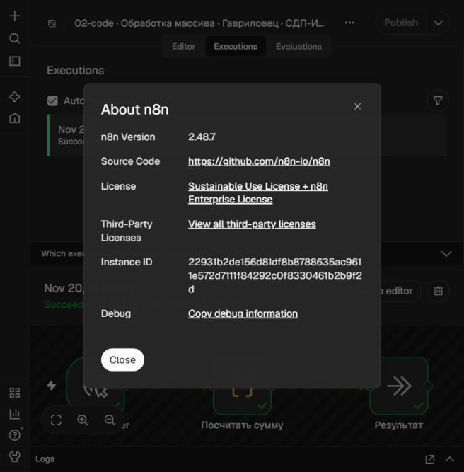
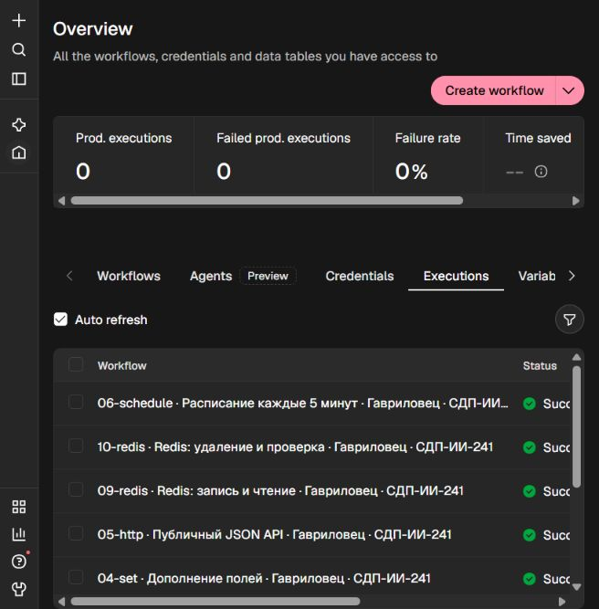

# Лабораторная работа №4. n8n

**Студент** Илья Гавриловец  
**Группа** СДП-ИИ-241

## Установка

В Docker Desktop через [compose.yaml](../compose.yaml) запущены n8n 2.48.7 и Redis 7. n8n доступен по адресу [http://localhost:5678](http://localhost:5678). Для проекта создана локальная учётная запись владельца.

Из папки `lab4`:

```powershell
docker compose up -d
docker compose ps
docker compose exec n8n n8n --version
```

Папка `.runtime/n8n` хранит рабочую базу n8n и настройки. Папка `.runtime/data` подключена к `/data`. Обе привязки видны в Compose. Для запуска по расписанию задан часовой пояс `Europe/Minsk`.



## Сценарии и проверка

Восемь файлов получены штатным экспортом n8n. Привязки локальных credentials исключены из JSON. Сценарии импортируются по одному через **Import from File**. Подключение Redis описано [отдельно](redis.md).

| Workflow | Узлы и проверенный результат | Скриншот |
| --- | --- | --- |
| [01. Ручной запуск](../flows/flow-01-manual-set.json) | Manual Trigger → Edit Fields → Code. Возвращаются фамилия, группа и тема `lab4/gavrilovets/basic` | [Выполнение](../screenshots/03-manual-set.png) |
| [02. Code](../flows/flow-02-code.json) | Manual Trigger → Code → No Operation. Код использует `const`, `let`, `for`, `if/else`, массив и объект. Сумма после замены отрицательных чисел нулями — `12` | [Выполнение](../screenshots/04-code.png) |
| [03. IF](../flows/flow-03-if.json) | Code возвращает два объекта. Для `payload = 12` срабатывает ветка true, для `payload = 3` — false. Порог — `10` | [Выполнение](../screenshots/05-if.png) |
| [04. Edit Fields](../flows/flow-04-set.json) | Добавляются тема, фамилия, группа и ISO-время через `$now.toISO()`. Code возвращает весь входной объект | [Выполнение](../screenshots/06-set.png) |
| [05. HTTP Request](../flows/flow-05-http.json) | GET к публичному API Cat Facts. Ответ читается как JSON. Code возвращает строку факта в `payload` и её длину | [Выполнение](../screenshots/07-http.png) |
| [06. Schedule Trigger](../flows/flow-06-schedule.json) | Публикация включает запуск каждые пять минут. Плановый запуск №8 завершился успешно 20.11.2026 в 14:50 по Минску | [Выполнение](../screenshots/08-schedule.png) |
| [09. Redis Set и Get](../flows/flow-09-redis.json) | Записывает строку в ключ `gavrilovets` и читает её обратно | [Выполнение](../screenshots/09-redis-set-get.png) |
| [10. Redis Delete и проверка](../flows/flow-10-redis.json) | Удаляет ключ. GET возвращает `null`, Code выдаёт `exists: false`. Отдельная проверка Redis EXISTS вернула `0` | [Выполнение](../screenshots/10-redis-delete-exists.png) |

Семь ручных сценариев выполнены из CLI n8n. Запуск Schedule Trigger сделан планировщиком. В этой версии n8n публикация требует производственного триггера. Сценарии с одним Manual Trigger можно сохранить в редакторе и запустить вручную.



## Примеры запросов к ИИ

> Подбери два массива для Code и IF в n8n. Нужны цикл for, условие if/else, объект с числовым payload и данные для обеих веток порога 10.

> Проверь поля нод Redis Set и Get в n8n. Предложи проверку отсутствия строкового ключа после Delete и объясни, как подтвердить результат штатной командой Redis EXISTS.

## Вывод

В n8n каждый узел получает набор объектов и передаёт свой результат следующему. В Code удобно преобразовывать массив, а IF наглядно показывает, куда ушёл каждый элемент. В Redis значение сохраняется между запусками разных сценариев. Расписание проверяется по истории executions, где видны время запуска и фактический успех.
